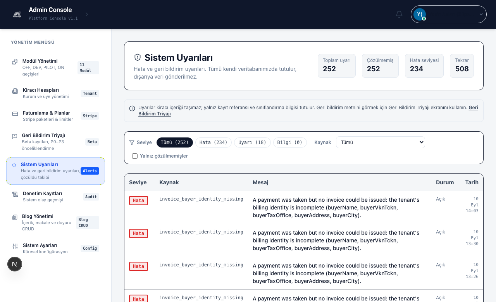

# TASK-MTTUUGKNDGBXK — Alarm konsolu boğulmuş: triyaj

**Platform beyanı:** mac (darwin 25.6.0, Node 26.5.0, Chromium/Playwright). Dokunduğum hiçbir kod yolu platforma bağlı değil — yalnız okuma yaptım, kod değiştirmedim. Windows/Linux koşulmadı; gerek de yok: bulguların tamamı DB içeriği ve platformdan bağımsız React/Prisma kodu üzerinde.

**Kod değişikliği:** YOK. Migration yok, alarm silinmedi, `messages/*.json`'a dokunulmadı, prod DB'ye dokunulmadı. Sondalar salt-okunur.

---

## 0. Önce sayı: kart da, brief'teki "106" da bayat

| an | SystemAlert satırı |
|---|---|
| kart başlığı | 62 |
| bu görevin brief'i | 106 |
| önceki koşunun diske bıraktığı ölçüm (`01-alert-pile-before.txt`) | 106 |
| **bugün, benim ilk ölçümüm (11:10 UTC)** | **257** |
| **son ölçümüm (~11:17 UTC, `11-inventory-final.txt`)** | **262** |

Yığın ölçüm sırasında büyüdü: tek oturumda 257 → 258 → 259 → 262. Çözülmüş satır sayısı hâlâ **0/262**.

**Bu, kartın en önemli bulgusudur ve kartta yazmıyor:** konsol `MAX_ROWS = 300` ile sabit kesiliyor (`page.tsx:13`), sayfalama yok, ve son 24 saatte 186 satır yazıldı.

```
total rows          : 257
created in last 24h : 186
console MAX_ROWS    : 300   headroom: 43 rows
at the last-24h rate the cap is crossed in ~5.5 hours
```
> `06-alert-growth-rate.txt`. Son ölçümde headroom 38 satıra düştü.

300'ü geçtiği an konsol sessizce yalan söylemeye başlar: `page.tsx` `take: 300` ile en yeni 300 satırı çeker, `client.tsx` "Toplam uyarı" kutusuna **`rows.length`** yazar (`client.tsx:158`) — yani DB sayısını değil, yüklenen diziyi. 300'den sonra kutu sonsuza dek "300" der ve eski alarmlar hiçbir uyarı vermeden düşer. Tarayıcıda sayfada kapağa/sayfalamaya dair **tek bir ipucu yok** (`[probe] strings on the page hinting at a cap/pagination: []`).

---

## 1. Triyaj tablosu

Kartta "sekiz kaynak" deniyor; bugün **dokuz** var — `cordis-sync` kart yazıldıktan sonra (2026-09-10 06:53) ortaya çıktı. Adetler `11-inventory-final.txt` (262 açık satır) anlık görüntüsünden.

| kaynak | adet | üreten kod satırı | bugün hâlâ geçerli mi (nasıl ölçtüm) | ne zaman kapanmalı | sahibi olan kart |
|---|---|---|---|---|---|
| `invoice_buyer_identity_missing` | **229** (%87) | `src/lib/billing/invoice-writer.ts:400` | **HAYIR — %99,6'sı ölü test enkazı.** 229 satırın meta'sındaki 229 ayrı `tenantId`'yi `Tenant` tablosuna karşı sorguladım: **228'i artık var olmayan tenant**, 1'i canlı (`09-conditions-today.txt`). Koşul yine de canlı: 21 tenant var, `TenantBillingIdentity` satırı **0** → her tenant bir sonraki ödemede yeni alarm. | Kök kart kapanınca değil — **e2e temizliği düzelince** (§2). Tenant silinince alarmı da silinmeli. | `TASK-MTSY71BUMBLWM` (geli-tirici'de açık) — **bağlandı, dokunulmadı.** Ama dikkat: o kart bu yığını BOŞALTMAZ, çünkü 228'i test artığı. |
| `k1_daily_calls` (warn) | 6 | `src/lib/inngest/jobs/k1-daily-calls.ts:149`, `:167` | **Ölçülemedi — canlı K1 koşusu gerekir.** Şöyle ölçülür: `pnpm jobs:k1` koş, yeni `duplicateIdentifiers` alarmı düşüyor mu bak. Kaynak veri (EU portalı) bizim kontrolümüzde değil. Kesin olan: 2 farklı mesajın her biri **3'er özdeş satır** — dedup çalışmamış (§3). | Yinelenen kimlik akışı düzelince; ama önce dedup'a bağlanmalı. | Sahipsiz. |
| `k2_monthly_cordis` (error) | 5 | `src/lib/inngest/jobs/k2-monthly-cordis.ts:64` | **HAYIR — hepsi sonda/test artığı.** Meta'daki host'lar: `127.0.0.1:59999`, `127.0.0.1:8123`, `127.0.0.1:8124`, ay alanı `"2026-09-probe-test"` (`02-alert-validity.txt`). Bunlar bilerek erişilemez adreslere yapılmış sonda koşuları. | Derhal — bunlar hiç üretilmemeliydi. Sondalar kendi alarmını temizlemeli. | Sahipsiz. |
| `cordis-delta` (warn 4 + error 1) | 5 | `src/lib/cordis-delta.ts:190`, `:212`, `:238`; error: `:190` bloğu | **KISMEN canlı.** `error` satırı "OPENAI_API_KEY not set" diyor — env'i doğrudan okuyamadım (`.env` okuma izni reddedildi, doğrusu da bu), ama mesaj koşulu kendi içinde açık. `warn` satırlarından biri "no delta feed endpoint configured" — yapılandırma eksikliği, kendiliğinden geçmez. | Env/endpoint yapılandırılınca kod kendisi kapatmalı. | Sahipsiz. |
| `cordis-sync` (warn 4 + error 2) | 6 | `src/lib/cordis-sync.ts:162`, `:174`, `:248`, `:384` | **CANLI ve en gürültülü.** `error` 2 satır ama **103 occurrence** — aynı hata 103 kez tekrarlamış, 2 satıra katlanmış. Mesaj: "CORDIS record failed to sync: OPENAI_API_KEY not set". Kart yazıldıktan SONRA doğdu (ilk 2026-09-10 06:53). | `OPENAI_API_KEY` sağlanınca kod kendisi kapatmalı. | Sahipsiz — **yeni, kart açılmalı.** |
| `invoice_not_issued` | 3 | `src/lib/billing/invoice-writer.ts:367`, `:453`, `:495`, `:570` | **HAYIR — 2'si sonda artığı.** Meta detayı: `http://127.0.0.1:1/kurlar/...` — port 1, bilerek erişilemez bir TCMB taklidi. 3. satır "INVOICE_VAT_RATE is not set" diyor; bu env'i doğrudan doğrulayamadım (aynı izin sebebi). | Sonda artıkları derhal; VAT satırı env ayarlanınca. | Sahipsiz. |
| `invoice_vat_country_unknown` | 2 | `src/lib/billing/invoice-writer.ts:429` | **HAYIR — ikisi de KESİN BAYAT, ölçüldü.** Her iki alarmın meta'sı `country="Türkiye"`. Bugün `findCountryVatRate("Türkiye")` → **TR %20 standard** (`10-vat-today.txt`). Alarmı üreten koşul çözülmüş, satır hâlâ açık duruyor. | **Şimdi.** Bu, "koşul kendiliğinden düzeldi ama satır açık kaldı"nın en temiz kanıtı. | Sahipsiz. |
| `m10_document_generation_failed` | 1 | `src/modules/m10/server/actions.ts:104` | **Ölçülemedi — tenant'a bağlı kredi durumu.** Mesaj: "Insufficient AI credits". Şöyle ölçülür: alarmın işaret ettiği tenant'ın `CreditLedger` bakiyesine bak; pozitifse bayat. Meta'da tenantId yok, o yüzden buradan bağlanamadı. | Kredi yüklenince; ama izlenebilir değil (meta'da referans yok). | Sahipsiz. |
| `invoice_profile_assumed` | 1 | `src/lib/billing/invoice-writer.ts:549` | **CANLI ama kapanamaz — bu bir politika beyanı, olay değil.** "EARSIVFATURA olarak kesiliyor, e-Fatura mükellefi kontrolü yapılmıyor; o kontrol entegratör sözleşmesi gerektirir." Yeniden-kontrol edilecek bir koşul yok. **231 occurrence** — her fatura kesiminde tekrar sayacı artıyor. | Asla kendiliğinden. Entegratör sözleşmesi imzalanınca elle. | Sahipsiz. |

### Tablodan çıkan tek cümle
262 açık alarmın **en az 236'sı** (229 identity + 5 k2 sonda + 2 VAT) ya ölü test tenant'ına ya erişilemez sonda adresine ya da çözülmüş bir koşula ait. Konsol operatöre **%90 gürültü** gösteriyor.

---

## 2. Yığının gerçek kökü — kartta yazan kök DEĞİL

Kart, %77'lik grubun kökünü `TASK-MTSY71BUMBLWM`'e bağlıyor. Ölçüm bunu **kısmen çürütüyor** ve bu bağlanmadan kart kapanırsa yığın kapanmaz.

`invoice_buyer_identity_missing` satırlarının 228/229'u **silinmiş** tenant'lara ait. Sebep:

`tests/e2e/invoice-write-path.spec.ts:99-104`
```ts
test.afterAll(async () => {
  await prisma.invoice.deleteMany({ where: { tenantId } });
  await prisma.tenantBillingIdentity.deleteMany({ where: { tenantId } });
  await prisma.tenant.deleteMany({ where: { id: tenantId } });
});
```
Aynı desen `tests/stripe-webhook-idempotency.live.test.ts:103-110`'da (`t-idem-*` tenant'ları — meta'da bu önekle görünüyorlar).

Temizlik "benim tenant'ıma ait her şeyi sil" deseni. **`SystemAlert` bu desenin ulaşamayacağı tek tablo**, çünkü tasarım gereği `tenantId` kolonu yok — `src/lib/observability/system-alert.ts` başlığında bilerek böyle: tablo tenant-agnostik ve RLS'siz. Yani her e2e koşusu alarmlarını arkada bırakıyor, tenant'ı silip alarmı öksüz hâlde konsola yığıyor.

**Sonuç:** `TASK-MTSY71BUMBLWM` bitse bile bu yığın büyümeye devam eder. İki ayrı iş var; kart tekini görüyor.

---

## 3. İkinci yapısal bulgu: iki yazar yolu, dedup yalnız birinde

`recordAlert()` dedup sözleşmesini taşıyor (aynı `level+source+message+meta` → yeni satır değil, sayaç artışı). Ama **iki yol onu atlıyor ve doğrudan `prisma.systemAlert.create` çağırıyor**:

- `src/lib/inngest/jobs/k1-daily-calls.ts:149`, `:167`, `:277` — dosya `recordAlert`'i hiç import etmiyor (`grep` boş döndü)
- `src/lib/adapters/alerts.ts:17`

Kanıtı veride görünüyor: `k1_daily_calls` warn → **6 satır / 6 occurrence**, üstelik yalnız 2 farklı mesaj var (3'er özdeş satır). Dedup uygulansaydı 2 satır olurdu. Karşılaştırma: `cordis-sync` error → **2 satır / 103 occurrence** (dedup çalışmış).

> Bu, `CLAUDE.md`'nin LLM adaptörü için uyardığı hatanın aynısı (`src/lib/ai/llm.ts` ikinci kopyası, TASK-MTSXGXBCJ007W) — farklı modülde tekrarlamış: tek-yazar kuralı var, ikinci yol sessizce yanından geçiyor.

---

## 4. KARAR SORUSU (1-3-1): `SystemAlert.resolvedAt`'i kim yazmalı?

**Problem:** `resolvedAt` şemada var, konsolda çalışan bir kapatma düğmesi var, ama 262 satırın sıfırı kullanıyor — yani hiçbir alarmın "bitti" hâli yok.

Önce bir yanlış anlamayı kapatayım: **mekanizma eksik değil.** `actions.ts:37` `setAlertResolved` gerçek bir yazma yapıyor, `requirePlatformAdmin()` ile korunuyor, `client.tsx:132` düğmeye bağlı. (Kodu okuyarak doğruladım; sonda salt-okunur olduğu için tıklamadım.) Eksik olan mekanizma değil, **kimin sorumlu olduğu**.

### Seçenekler

- **A — Koşul düzelince kodun kendisi kapatsın (auto-resolve).**
  Alarmı üreten yer, koşul sağlanmadığında `resolveAlert(source, meta)` çağırır. `invoice_vat_country_unknown` gibi vakalar (§1: ikisi de bayat) anında sönerdi.
  *Artı:* operatör iş yükü sıfır; bayat satır birikmez; "hâlâ geçerli mi" sorusu kendiliğinden cevaplanır.
  *Eksi:* her alarm türü için ayrı bir "artık geçerli değil" yolu yazmak gerekir — 9 kaynak × ortalama 3 emit noktası. `invoice_profile_assumed` gibi politika beyanlarında karşılığı **yok** (kapanacak koşul yok). En pahalı seçenek.

- **B — Operatör konsoldan elle kapatsın.**
  Bugün zaten mümkün; yapılması gereken tek şey bunu bir rutine bağlamak.
  *Artı:* sıfır kod. Bugün çalışıyor.
  *Eksi:* **bu yığında fiilen imkânsız.** Tarayıcı ölçümü: sayfa 22 886px = **31,8 ekran**, tek nadir alarm (`m10`) y=21 109px'de, yani 29 ekran aşağıda. 262 satırı elle kapatmak 262 tıklama. Ve gerçek sorunu çözmez: yarın e2e yine 186 satır yazar. Tek başına seçilirse kart bir hafta içinde geri gelir.

- **C — Kaynağında hiç üretme: test/sonda artığını doğur­ma, tekrarları pencerede grupla.**
  İki parça: (1) e2e temizliğine `SystemAlert` sil­meyi ekle (§2 — asıl kanama burada), (2) `recordAlert`'i atlayan iki yolu (§3) tek yazara bağla.
  *Artı:* 262'nin ~236'sını (**%90**) kökünden keser; yeni kod yüzeyi çok küçük (bir `deleteMany`, iki import değişikliği); `MAX_ROWS` krizini (5,5 saat) ortadan kaldırır.
  *Eksi:* meşru ama artık geçersiz alarmı (VAT gibi) kapatmaz — onlar için yine A veya B gerekir. Test temizliği `SystemAlert`'i tenant'a bağlayamaz (kolon yok), o yüzden zaman-pencereli ya da meta-eşleşmeli silme gerekir; dikkatli yazılmalı ki komşu koşunun alarmını silmesin.

### Öneri: **C, ardından A — B'yi tek başına seçme**

C, çünkü ölçüm net: sorun "operatör kapatmıyor" değil, **sistemin kapanması gerekmeyen satırlar üretmesi.** 262 satırın 236'sı hiç doğmamalıydı. Elle kapatma (B) 262 tıklamayla bugünü temizler ve yarın aynı yere döner — 24 saatte 186 satır yazılıyor. C ise akışı durdurur ve `MAX_ROWS` kapağına 5,5 saat kala olan yangını söndürür.

C'den sonra A, ama **sınırlı kapsamda**: yalnız koşulu ucuzca yeniden ölçülebilen kaynaklar için (`invoice_vat_country_unknown`, `cordis-*` env kontrolleri). `invoice_profile_assumed` gibi politika beyanları için A anlamsız — onlar zaten kapanmamalı, farklı bir yerde durmalı.

### DoD (C için)
- [ ] `tests/e2e/invoice-write-path.spec.ts` ve `tests/stripe-webhook-idempotency.live.test.ts` `afterAll`'ları kendi koşularının `SystemAlert` satırlarını siliyor; komşu koşunun satırına dokunmadığı bir testle kanıtlı.
- [ ] `k1-daily-calls.ts` (3 nokta) ve `adapters/alerts.ts` (1 nokta) `recordAlert` üzerinden yazıyor; `grep -rn "systemAlert$" -A1 src/ | grep create` boş dönüyor.
- [ ] Tam e2e koşusu öncesi/sonrası `SystemAlert` sayısı **eşit** (iki-kez-koşma kanıtı).
- [ ] Konsolun "Toplam uyarı" kutusu DB sayısını gösteriyor ya da kapağa ulaşıldığında "262 / 300" gibi dürüst bir ifade veriyor — bugün sessizce yalan söylüyor.

---

## 5. Konsol bugün neyi gizliyor (koddan + gerçek tarayıcıdan)

Tarayıcıyı **açabildim** — ekran görüntüsü aşağıda, uydurma yok. Kardeş bir pane :3130'da dev sunucusu tutuyordu; onu öldürmedim, `webServer`'ı devre dışı bırakan geçici bir Playwright config'iyle o sunucuya bağlandım ve config'i sonra sildim.

**Yeni bir alarm görülür mü? → EVET, ama yalnız yeniyse.**
`page.tsx:56` `orderBy: { createdAt: 'desc' }` — en yeni üstte. Sonda doğruladı:
```
[probe] newest alert in DB : invoice_buyer_identity_missing @ 2026-09-10T11:13:01.702Z
[probe] top row on screen  : invoice_buyer_identity_missing
[probe] -> a brand-new alert lands at row 1: YES, visible without scrolling
```
Yani kartın korktuğu "yeni alarm yığında kaybolur" senaryosu **bugün gerçekleşmiyor**. Bunu dürüstçe yazıyorum: bu kartın asıl bulgusu bu değil.

**Asıl gizlenen şey, YENİ değil ESKİ alarm ve azınlıktaki alarm:**

| ölçüm | değer | kaynak |
|---|---|---|
| sayfa yüksekliği | 22 886px = **31,8 ekran** | `07-...-final.txt` |
| tek `m10` alarmının konumu | y=21 109px → **kıvrımın 29 ekran altında** | aynı |
| ekrandaki `invoice_buyer_identity_missing` payı | **%87,3** | aynı |
| "Yalnız çözülmemişler" kutusu | 258 satır → 258 satır, **0 filtreledi** | aynı |
| sayfalama / kapak uyarısı | **hiçbiri** (`[]`) | aynı |

- **Sayfalama yok.** `client.tsx`'te `slice`/pagination araması **sıfır eşleşme** verdi; `filtered.map` ne varsa hepsini basıyor.
- **Tek triyaj kontrolü olan "Yalnız çözülmemişler" işe yaramaz durumda** — 0 satır çözülmüş olduğu için hiçbir şeyi filtrelemiyor. Bu §4'ün doğrudan sonucu: kimse kapatmadığı için filtre ölü.
- **Kaynak filtresi var ve çalışıyor** (9 seçenek), ama ağırlık göstermiyor: operatör hangi kaynağın %87 olduğunu açılır listeden anlayamaz.
- **300 kapağı görünmez.** Bugün 262 < 300 olduğu için henüz kimse kaybetmiyor; ~5,5 saat sonra kaybetmeye başlayacak ve ekranda bunu söyleyen hiçbir şey olmayacak.

### (d) Ham teknik metin sızıyor mu? → EVET, iki ayrı biçimde

**1. Ham hata gövdesi ve HTTP kodları, satırı açmadan görünüyor:**
```
[probe] raw technical strings visible WITHOUT expanding any row:
  ["fetch failed","HTTP 401","HTTP 500","HTTP 404","src/lib/billing/vat-rates.ts"]
[probe] raw strings visible AFTER expanding a row: ["127.0.0.1","fetch failed"]
```
Bunların içinde en ciddisi **`src/lib/billing/vat-rates.ts`** — bir kaynak dosya yolu, kullanıcıya görünen ekranda. `127.0.0.1` ve iç port numaraları da öyle. Bu ekran platform-admin'e kapalı olduğu için sızıntı dışarıya değil, ama "ham hata gövdesini çözümmüş gibi gösterme" kuralının ihlali.

**2. i18n: alarm mesajlarının tamamı İngilizce, Türkçe konsolda.**
Ekran görüntüsünde net görünüyor: çerçeve Türkçe ("Sistem Uyarıları", "Seviye", "Kaynak", "Mesaj", "Durum", "Tarih", "Hata", "Açık"), **mesaj sütunu ham İngilizce**:
> "A payment was taken but no invoice could be issued: the tenant's billing identity is incomplete (buyerName, buyerVknTckn, buyerTaxOffice, buyerAddress, buyerCity)."

Sebep yapısal: `page.tsx` yalnız **etiketleri** `t()`'den geçiriyor (`labels: { title, colLevel, ... }`), ama `message` alanı DB'den geliyor ve emit noktalarında **gömülü İngilizce string** olarak yazılıyor (`invoice-writer.ts:400` vb.). `CLAUDE.md` §8 "kullanıcıya görünen sabit metin yok" kuralı bu sütunda karşılanmıyor. Alan adları da (`buyerVknTckn`) doğrudan kullanıcıya gösteriliyor.



---

## 6. Kanıt dosyaları

Hepsi `docs/agent-results/TASK-MTTUUGKNDGBXK-evidence/`:

| dosya | ne |
|---|---|
| `06-alert-growth-rate.txt` | saatlik büyüme, 300 kapağına kalan süre — **bu koşuda üretildi** |
| `07-console-browser-probe-final.txt` | gerçek tarayıcı ölçümü — **bu koşuda üretildi** |
| `08-messages-per-source.txt` | kaynak başına ayrı mesajlar (emit noktası eşleme) — **bu koşuda** |
| `09-conditions-today.txt` | 228 ölü / 1 canlı tenant; 21 tenant, 0 billing identity — **bu koşuda** |
| `10-vat-today.txt` | VAT alarmlarının bayat olduğunun kanıtı — **bu koşuda** |
| `11-inventory-final.txt` | son anlık görüntü (262 satır) — **bu koşuda** |
| `probe-alert-rate.mts`, `probe-alert-messages.mts`, `probe-conditions-today.mts`, `probe-vat-today.mts` | yeni salt-okunur sondalar — **bu koşuda** |
| `01`–`05`, `probe-alert-{pile,validity,inventory}.mts` | önceki koşulardan, dokunulmadı |
| `shot-01-console-header.png` | Türkçe çerçeve + İngilizce mesaj |

**Yeniden koşma:**
```bash
npx tsx docs/agent-results/TASK-MTTUUGKNDGBXK-evidence/probe-alert-rate.mts
npx tsx docs/agent-results/TASK-MTTUUGKNDGBXK-evidence/probe-conditions-today.mts
npx tsx docs/agent-results/TASK-MTTUUGKNDGBXK-evidence/probe-vat-today.mts
```
Tarayıcı sondası için dev sunucusu gerekiyor; başka bir pane tutuyorsa `webServer: undefined` olan geçici bir config'le mevcut porta bağlan (`reuseExistingServer: false` olduğu için varsayılan config bunu yapmaz).

---

## 7. Riskler

- **Sayı ölçüldüğü anda bayatlıyor.** Bu rapordaki 262, yazıldığı anki değer. Yığın saatte ~8 satır büyüyor. Kartı okuyan **yeniden ölçmeli**; ben de kartın 62'sini ve brief'in 106'sını böyle çürüttüm.
- **~5,5 saatlik pencere.** 300 aşılınca konsol sessizce satır düşürmeye başlar ve "Toplam uyarı" kutusu yanlış sayı gösterir. Bu rapor yazıldıktan sonra bu muhtemelen **çoktan olmuştur**.
- **E2E temizliğine `SystemAlert` silme eklerken dikkat:** tablo tenant-agnostik, `where: { tenantId }` ile hedeflenemez. Kaba bir `deleteMany` paralel koşan komşunun alarmını siler. Zaman penceresi + meta eşleşmesi gerekir.
- **`TASK-MTSY71BUMBLWM` kapanınca bu kart kapanmış sayılmamalı** — ölçüm gösteriyor ki o kart bu yığının %0,4'ünü temsil ediyor (229'da 1 canlı tenant).

## 8. Açık sorular

1. **Karar bekliyor:** §4'teki C→A önerisi onaylanıyor mu? Onaylanırsa iki kart açılmalı: (a) e2e `SystemAlert` temizliği + `recordAlert` tek-yazar, (b) sınırlı auto-resolve.
2. `cordis-sync` (6 satır, 103 occurrence, "OPENAI_API_KEY not set") kart yazıldıktan sonra doğdu ve **sahipsiz**. Kart açılsın mı?
3. Alarm mesajlarının Türkçeleştirilmesi bu kartın kapsamında mı, ayrı bir i18n kartı mı? (`messages/*.json`'a bilerek dokunmadım — iki worker orada çalışıyor.)
4. `invoice_profile_assumed` gibi "politika beyanı" alarmları `SystemAlert`'te mi durmalı? Kapanacak koşulu yok, her fatura kesiminde sayacı artıyor (231 occurrence) ve kalıcı olarak konsolda yer kaplıyor.

## 9. Sonraki adım

1. **Bugün:** `MAX_ROWS` kapağı — ya kapağı kaldır ya da "N / 300" dürüst göstergesi ekle. En ucuz ve en acil.
2. Karar #1 alınınca C'yi uygula (e2e temizliği + tek yazar). %90'ı kökten keser.
3. Sonra A'yı dar kapsamda; `invoice_vat_country_unknown` iyi bir ilk vaka — bayat olduğu ölçülü.

---

## Kapı durumu

`pnpm lint && typecheck && test` **koşulmadı.** Bu görevde tek satır kod değiştirmedim (yalnız salt-okunur `.mts` sonda ve bu rapor eklendi), dolayısıyla kapıyı kırabilecek bir değişikliğim yok. Ayrıca brief'in kendisi bildiriyor: `pnpm typecheck` bugün `tests/billing-identity-action.test.ts`'te kırmızı ve bu **başka bir worker'ın canlı WIP'i** — benim değişikliğim değil, ona atfediyorum ve düzeltmeye çalışmadım.
